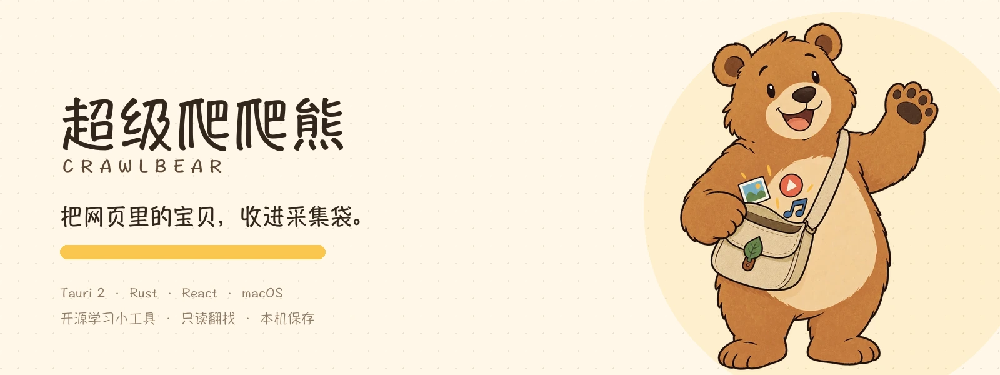
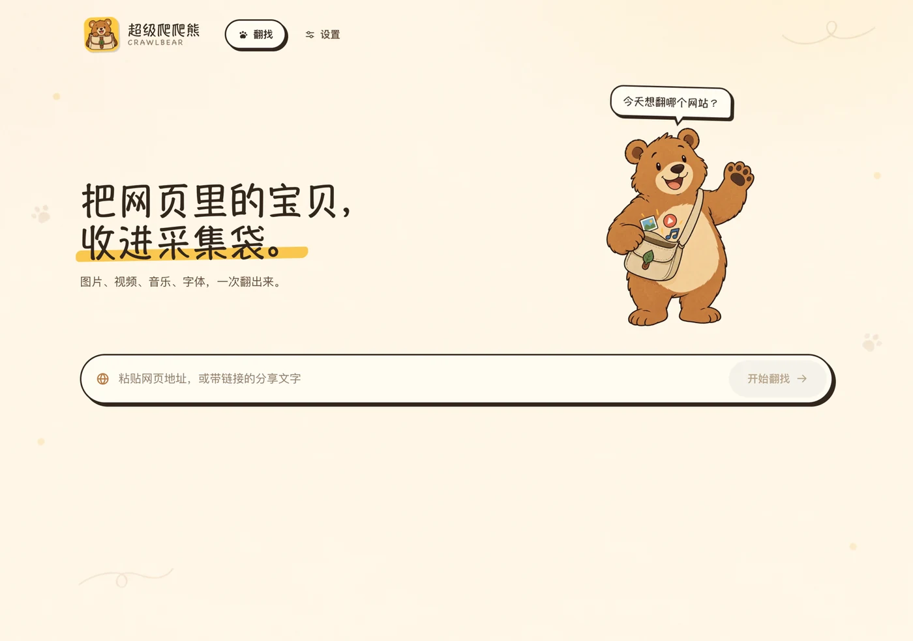
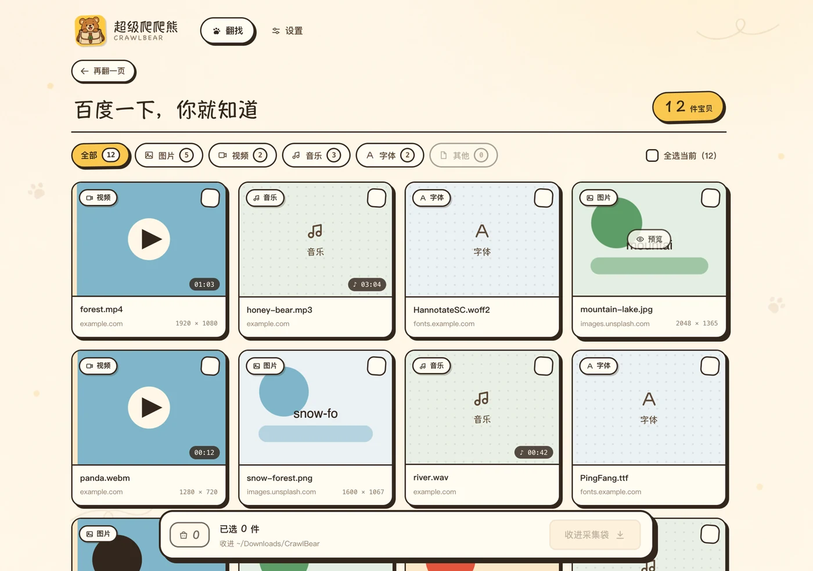

<div align="center">



**Paste one URL. Pull the images, videos, music and fonts from a webpage into a local folder.**


**Website:** [https://we.miework.cn/crawl-bear/index.html](https://we.miework.cn/crawl-bear/index.html)

[中文](README.md) · English

</div>

## What is this

CrawlBear (超级爬爬熊) is a local media crawler for macOS. Paste any webpage URL: it opens an invisible browser window, scans the page for images, videos, music and fonts, then lets you filter and batch-download the results.

No cloud, no account, no telemetry. Sites that require login are opened in your own WebView, where you sign in manually; cookies never leave your Mac.

The repository is a **pnpm workspace**:

| Package | Description |
| --- | --- |
| `apps/desktop` | macOS desktop app (Tauri 2 + Rust + React) |
| `apps/website` | Marketing site (Vite + React + TypeScript), deployed at [we.miework.cn/crawl-bear](https://we.miework.cn/crawl-bear/index.html) |
| `promos/crawl-bear-promo` | Marketing film: 60s promo video (Remotion), see [Promo film](#promo-film) |

The full repository map and package responsibilities live in [docs/STRUCTURE.md](docs/STRUCTURE.md) (Chinese).

## Features

- **Any website**: paste a page URL or share text; `https://` is optional and added automatically.
- **More than ``**: scans `picture/srcset`, lazy-loaded `data-*` attributes, `<video>/<audio>/<source>`, posters, CSS backgrounds, `@font-face`, `<link rel=preload>`, `og:image/video`, inline styles, CSSOM and `performance` resource entries.
- **Four media types**: images, videos, music and fonts, with type filters, counts and batch selection.
- **Click to preview**: open any resource in a modal — large images, video/audio playback and live font samples.
- **Site-specific parsing**: for X/Twitter, YouTube, Bilibili, Douyin and other supported sites, the results page shows a “Site-specific parsing enabled” badge and prefers the highest-quality source available.
- **Login reuse**: Bilibili, Douyin, X and YouTube are built in as one-click login sites; other sites can be added manually. Sign in through the embedded window and later crawls/downloads reuse the local cookie. The app only shows the cookie count, never the values.
- **Controlled downloads**: group files by site domain; concurrency 1–5; cancellable; HLS/DASH is remuxed to MP4 with the in-app FFmpeg extension; every item reports success or failure.
- **Native feel**: fixed top bar, single-screen home, dedicated results page, minimal macOS menu (About / Settings / Quit) plus a native Edit menu; context menu and text selection are disabled.
- **Hand-drawn bear**: “Papa” the bear accompanies the crawl with sticker-style visuals and light framer-motion animations that respect reduced motion.
- **Chinese / English UI**: follows the system language by default, with a manual switch in Settings. The website auto-detects the browser language and has a language switch in the nav.

## Sites with dedicated support

These sites use a dedicated extraction path instead of the generic crawler, and show a “Site-specific parsing enabled” badge on the results page.

| Site | Supported links | Dedicated support |
| --- | --- | --- |
| X / Twitter | `x.com/.../status/...`, `twitter.com/...` | Skips low-quality HLS variants and keeps the highest tweet video stream (HLS muxing needs the FFmpeg extension) |
| YouTube | `youtube.com/watch?v=...`, `youtu.be/...`, `/shorts/...` | Self-developed visionOS innertube extraction; 1080P H.264 + AAC muxed to MP4 with FFmpeg |
| Bilibili | `bilibili.com/video/BV...`, `av...`, `b23.tv/...`, multi-part `?p=N` | WBI-signed playurl; quality follows the signed-in account; up to 1080P H.264; each part becomes its own entry |
| Douyin | `v.douyin.com/...`, `douyin.com/video/<id>`, `/note/<id>` | Mobile share-page extraction; watermark-free 1080P; supports both video and image posts |

X, YouTube, Bilibili and Douyin also have one-click login presets in **Settings → Login sites**. Other sites use the generic crawler; open a GitHub Issue if you want dedicated support for one.

## Screenshots

### Home



### Crawling

The progress bar shows a centered glowing percentage while the bear switches to a searching pose.


### Results

Filter by type, select all, and batch-download into the collection bag. Results open on their own page with an independently scrolling list.



### Settings

Download folder, default types, concurrency, scrolling, item limit and login sites are all stored locally.


## Promo film

`promos/crawl-bear-promo` is the marketing sub-package: a **60s, 1920×1080 / 30fps** product film written in Remotion (the first 6s is a personal prologue, then nine product scenes) — every frame is a React component, the soundtrack is synthesized by a script, so there is no editor project and no licensed stock media involved.


- Ten scenes: prologue (please spare a minute) → the reason (wanted to save media from web pages) → birth (so I wrote one, and Papa the bear was born) → paste a URL → crawling → results → into the bag → dedicated parsers → local-only → end card;
- Preview: `pnpm dev:promo` (Remotion Studio, scrub the timeline frame by frame);
- Two cuts: `CrawlBearPromo` (standard) and `CrawlBearPromoNoLink` (no-links cut for strict platforms such as Douyin / WeChat Channels — domains become `xxxx.xx.com` placeholders, the parser scene uses generic site types instead of platform names, and the end card says “私聊作者获取” instead of showing a URL);
- Export: `pnpm render:promo` → `promos/crawl-bear-promo/out/crawl-bear-promo.mp4`;
- Text / duration / music edits: see [promos/crawl-bear-promo/README.md](promos/crawl-bear-promo/README.md);
- Only one image needs generating (the Da Fei Yu photo in the prologue); the full prompt is in [promos/crawl-bear-promo/ASSETS.md](promos/crawl-bear-promo/ASSETS.md) — drop it into `generated/` and run `pnpm --filter @crawl-bear/promo art`.

## Quick start

### Requirements

- macOS 13+
- Node.js 20+
- Rust 1.77+ (rustup) and Xcode Command Line Tools
- System `/usr/bin/curl`
- No system ffmpeg required. Before the first YouTube/Bilibili or HLS download, install the in-app FFmpeg extension from **Settings → Extensions**.
- Promo film (optional): Remotion downloads Chrome Headless Shell on the first render; re-synthesizing the soundtrack needs `python3` + `numpy`.

### Extension manager

The Extensions panel in Settings currently provides FFmpeg:

- Download a static build for your architecture; the app extracts, verifies and installs it under its private data directory.
- It never writes to `/opt/homebrew`, `/usr/local` or the system PATH, and never invokes a global ffmpeg.
- Downloads support resume/retry; after install, version, size and license are shown.
- You can remove it at any time; YouTube/Bilibili muxing and HLS downloads will ask you to reinstall it.

### Install dependencies

```bash
pnpm install
```

### Development

```bash
# Desktop app (the first run compiles Rust dependencies)
pnpm dev:desktop

# Website, http://localhost:5173
pnpm dev:web

# Promo film — Remotion Studio, http://localhost:3000
pnpm dev:promo
```

### Build and release

```bash
# Desktop app
pnpm build:desktop

# Website
pnpm build:web

# Promo film bundle (bundle only, no render)
pnpm build:promo

# Build all three packages: both frontends + promo bundle
pnpm build

# Render the promo film to MP4 (needs Chrome, 2–4 min)
pnpm render:promo

# Build a distributable macOS package (ad-hoc signed + install guide)
pnpm package:macos
```

Desktop bundle: `apps/desktop/src-tauri/target/release/bundle/macos/CrawlBear.app`.

`pnpm package:macos` re-applies the ad-hoc signature and writes to `dist/` (ignored by git, do not commit):

- `dist/CrawlBear-macOS.pkg`: installs to `/Applications` automatically (recommended for regular users);
- `dist/CrawlBear-macOS.zip`: portable bundle with the app and install guide.

Without an Apple Developer account, first launch is blocked by Gatekeeper. Send [docs/INSTALL-macOS.md](docs/INSTALL-macOS.md) along with the package and follow the right-click / Terminal steps there. Do not disable Gatekeeper globally.

### Image and icon assets

```bash
# Generated art -> app WebP + website copies + rounded icon
python3 scripts/prepare_assets.py

# Regenerate Tauri icons after changing the icon source
pnpm --filter @crawl-bear/desktop exec tauri icon ../../design-assets/app-icon-rounded.png

# Promo film: turn generated 2K art into WebP (prompt list in promos/crawl-bear-promo/ASSETS.md)
pnpm --filter @crawl-bear/promo art

# Promo film: re-synthesize music and SFX (python3 + numpy, idempotent)
pnpm --filter @crawl-bear/promo audio
```

## Usage

1. Paste a webpage URL on the home screen, e.g. `https://developer.mozilla.org/` (the protocol is optional).
2. Wait for the bear to finish; the results page opens automatically.
3. Filter with All / Images / Videos / Music / Fonts / Other; click a card to preview.
4. Select the assets you need (or click “Select all visible”), then click “Collect” at the bottom.
5. Files are saved under **Settings → Download folder**, by default `~/Downloads/CrawlBear/<site-domain>/`.

### Login sites

Add a site URL in **Settings → Login sites**, click “Open login” and sign in manually in the separate window. Close the window and crawl again. Login windows are reused per domain; “Clear” only removes local cookies.

### Settings

| Setting | Description |
| --- | --- |
| Download folder | Root folder for downloads; a subfolder per site domain is created |
| Default types | Media types shown by default in results |
| Concurrency | Number of parallel downloads, 1–5 |
| Auto scroll | Scroll the page first to trigger lazy loading, then extract |
| Max items | Upper limit for one crawl, 50–2000 |
| Login sites | Sites whose content requires login |
| Language | System / 中文 / English |

## Project structure

```text
apps/                             Applications (installed / visited by users)
  desktop/                        macOS desktop app (Tauri 2 + Rust + React)
    src/                          React UI (app / features / shared)
    src-tauri/                    Rust backend, Tauri config and icons
    public/assets/                In-app WebP art (bear, paper, logo)
  website/                        Marketing site
    src/                          Vite + React pages
    public/assets/                brand / shots / generated images
    ASSETS.md                     Website image prompts
promos/                           Marketing assets (not part of the app build)
  crawl-bear-promo/               60s promo film (Remotion, with prologue)
    src/                          theme / lib / components / scenes / audio
    public/assets/                brand / shots / generated images
    public/audio/                 Synthesized soundtrack and SFX
    scripts/                      make_audio.py / apply_art.py
    BRIEF.md · ASSETS.md          Production guide / image prompts
assets/readme/                    README and doc images
design-assets/                    Generated art originals (local, not committed)
scripts/prepare_assets.py         Generated art -> WebP / icons / website sync
docs/
  STRUCTURE.md                    Repository map: packages, deps, asset pipelines, where to change what
  design.md                       Design system: brand, color, type, layout, motion
  assets.md                       Image asset checklist and prompts
  ARCHITECTURE.md                 Layers, data flow, extension points
  API_CONTRACT.md                 Commands / events / error codes
  media-extraction.md             Generic extraction script and test report
pnpm-workspace.yaml               Workspace config (apps/* + promos/*)
```

> `design-assets/`, `docs/screenshots/` and `docs/archive/` stay local and are not committed. Original generated art can be recreated from prompts in `docs/assets.md`.

## Architecture and docs

| Document | Contents |
| --- | --- |
| [docs/STRUCTURE.md](docs/STRUCTURE.md) | Repository map: package responsibilities, dependency rules, asset pipelines, release flow (Chinese) |
| [docs/design.md](docs/design.md) | Design system: hand-drawn sticker style, typography, motion, copy, accessibility |
| [docs/ARCHITECTURE.md](docs/ARCHITECTURE.md) | Rust / React layers, data flow, extension points |
| [docs/API_CONTRACT.md](docs/API_CONTRACT.md) | Tauri commands, events and error codes |
| [docs/media-extraction.md](docs/media-extraction.md) | Generic extraction script and dual-engine test report |
| [docs/assets.md](docs/assets.md) | Image prompts for bear art, paper and icons |
| [apps/website/ASSETS.md](apps/website/ASSETS.md) | Website hero / preview / social image prompts |
| [promos/crawl-bear-promo/README.md](promos/crawl-bear-promo/README.md) | Promo film: preview, render, storyboard, structure |
| [promos/crawl-bear-promo/ASSETS.md](promos/crawl-bear-promo/ASSETS.md) | Image list for the film: one image + full prompt |

## Testing and verification

```bash
# Rust unit tests (URL, naming, classification, download paths)
pnpm test:rust

# Type-check and build all three packages (including the promo bundle)
pnpm build
```

Completed verification:

- all 50 Rust tests pass (3 network integration tests are ignored by default);
- real WKWebView crawl of the Baidu homepage: 79 images and 6 fonts found; `.js` / `.css` and other non-media resources filtered out;
- release macOS app smoke test, embedded assets and icon checks pass;
- home, crawling, results, preview modal, download-complete and settings screens were checked screen by screen (screenshots are local validation artifacts and are not committed);
- both the website and desktop app build in production mode under the pnpm workspace;
- the promo film was checked frame by frame at key beats and test-rendered to MP4 with its audio track; `promos/` builds under the same pnpm workspace as `apps/`.

## Known limitations

- macOS only; Windows/Linux would need platform-specific `open`, path and WebView handling.
- `blob:` / MSE streams, resources inside iframes, closed Shadow DOM and backgrounds injected by scripts after extraction are not covered.
- Some sites use anti-bot measures, login walls or CAPTCHAs. CrawlBear does not bypass CAPTCHAs; it only reuses a login you completed manually.
- YouTube, Bilibili and Douyin page videos are extracted in-app; video pages from other sites (Vimeo, etc.) are not supported for in-app downloads yet.
- Bilibili bangumi, movies, paid and “charging-exclusive” content are not supported yet; anonymous downloads top out at 480P.
- Douyin supports public video and image posts; live streams, profile batches and collections are not supported yet, and private or deleted posts will report a failure.
- YouTube/Bilibili downloads require the FFmpeg extension from **Settings → Extensions**; proxy environments are detected from macOS system settings.
- Signed CDN URLs can expire; URLs are re-collected before each download and never cached.
- Hidden windows do not trigger display refresh; a timer fallback keeps `requestAnimationFrame` alive. Lazy-loaded images that depend on `IntersectionObserver` may be fewer than in a visible browser.
- Only download content you have the right to save. Respect each site’s terms and copyright law; do not redistribute.

## Disclaimer

CrawlBear is an open-source learning tool that reads public pages locally. It is not intended for any improper use. Respect website terms and copyright; save only content you are allowed to use.

## License

Released under the [MIT License](LICENSE).

## Acknowledgements

[Tauri](https://tauri.app/) · [React](https://react.dev/) · [Ant Design](https://ant.design/) · [framer-motion](https://www.framer.com/motion/) · [ffmpeg](https://ffmpeg.org/)
