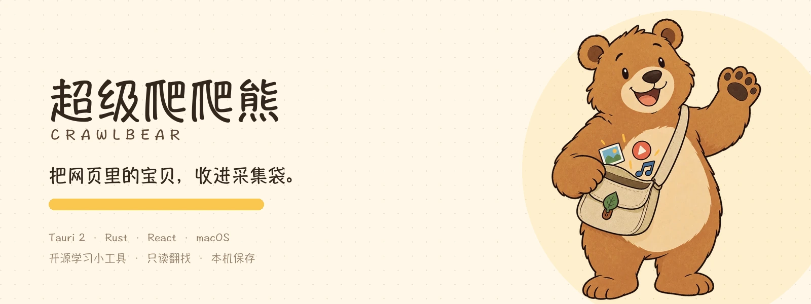
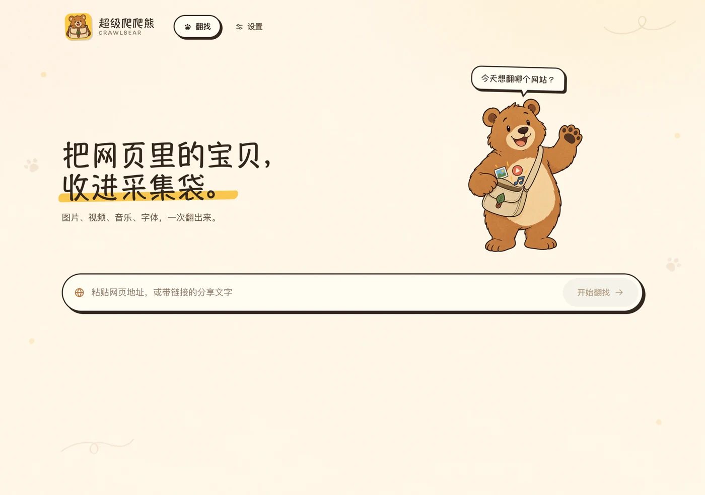
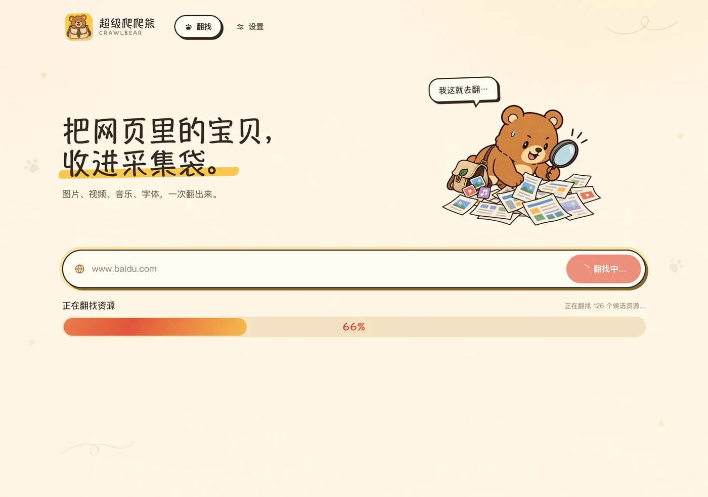
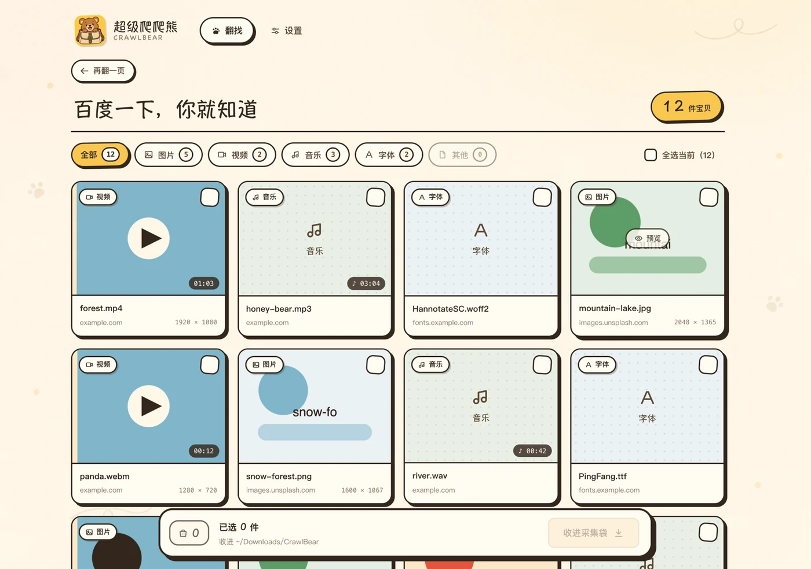
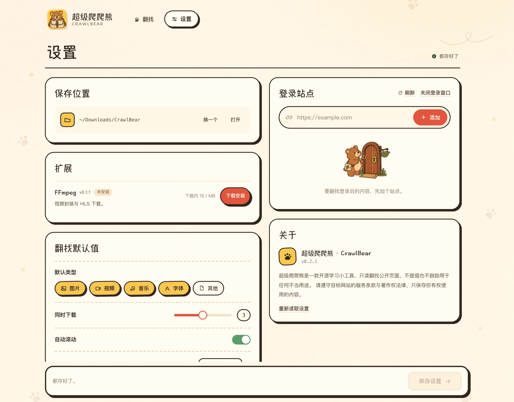

<div align="center">



**输入一个网址，把网页里的图片、视频、音乐与字体收进本地文件夹。**


</div>

## 这是什么

超级爬爬熊（CrawlBear）是一个跑在 macOS 本机的网页媒体翻找工具。粘贴任意网页地址，它会打开一个不可见的浏览器窗口，扫描页面里的图片、视频、音乐与字体，让你筛选后批量保存到本地。

没有云端、没有账号、没有遥测；需要登录的站点也只在你自己的 WebView 里手动登录，Cookie 不会离开这台电脑。

仓库使用 **pnpm workspace** 管理：

| 包 | 说明 |
| --- | --- |
| `apps/desktop` | macOS 桌面应用（Tauri 2 + Rust + React） |
| `apps/website` | 官网（Vite + React + TypeScript） |

## 特性

- **任意网站**：输入页面地址或粘贴分享文字，可省略 `https://`，会自动补齐。
- **不止 ``**：同时扫描 `picture/srcset`、懒加载 `data-*`、`<video>/<audio>/<source>`、海报、CSS 背景图、`@font-face`、`<link rel=preload>`、`og:image/video`、内联样式、CSSOM 与 `performance` 资源条目。
- **四类媒体**：图片、视频、音乐、字体，可多选筛选、按类型计数、批量勾选。
- **即点即看**：点击任意资源弹出预览窗——图片大图、视频/音频直接播放、字体实时样张。
- **专站解析**：X/Twitter、YouTube 等命中专属解析时，结果页显示「专属解析已启用」标签，并优先取站点内最高清晰度资源。
- **登录站点**：在「设置 → 登录站点」添加站点并打开内嵌登录窗口，Cookie 保存在本机，后续翻找与下载自动复用；只展示 Cookie 数量，不猜测登录状态。
- **可控下载**：按站点域名归档到指定目录；并发 1–5；支持取消；HLS/DASH 通过应用内 FFmpeg 扩展合并为 MP4；每个资源的成功/失败状态实时反馈。
- **原生手感**：固定顶栏、单屏首页、独立结果页；macOS 菜单保留应用菜单（关于 / 设置 / 退出）与中文「编辑」菜单（撤销 / 重做 / 剪切 / 复制 / 粘贴 / 全选）；禁用右键菜单与文本选中。
- **手绘小熊**：卡通漫画风的小熊「爬爬」会陪你翻找，贴纸质感与轻量动效（framer-motion，遵循 reduced-motion）。

## 界面

### 首页



### 翻找中

进度条居中显示流光百分比，小熊切换成翻找姿态。



### 结果页

按类型筛选、全选、批量收进采集袋；翻找完成后进入独立结果页，列表在页内滚动。



### 设置

保存位置、默认类型、并发、滚动、单次上限与登录站点都保存在本机。



## 快速开始

### 环境要求

- macOS 13+
- Node.js 20+
- Rust 1.77+（rustup）与 Xcode Command Line Tools
- 系统 `/usr/bin/curl`
- 不再需要系统安装 ffmpeg；首次使用 YouTube 下载/HLS 前，在应用内「设置 → 扩展管理」安装即可

### 扩展管理

设置里有一个「扩展」面板，目前提供 FFmpeg：

- 点击「下载安装」后，应用会下载对应架构的静态构建，解压、校验并安装到应用私有数据目录；
- 不会写入 `/opt/homebrew`、`/usr/local` 或系统 PATH，也不会调用全局 ffmpeg；
- 下载支持断点重试，安装完成后显示版本、体积和许可证；
- 可以在同一面板移除；移除后依赖 FFmpeg 的 YouTube 合并/HLS 下载会提示重新安装。

### 安装依赖

```bash
pnpm install
```

### 开发运行

```bash
# 桌面应用（首次会编译 Rust 依赖）
pnpm dev:desktop

# 官网，http://localhost:5173
pnpm dev:web
```

### 构建发布

```bash
# 桌面应用
pnpm build:desktop

# 官网
pnpm build:web

# 两个包一起做前端构建
pnpm build

# 打可直接分发的 macOS 包（ad-hoc 签名 + 安装说明）
pnpm package:macos
```

桌面应用产物：`apps/desktop/src-tauri/target/release/bundle/macos/CrawlBear.app`。
`pnpm package:macos` 会重新做 ad-hoc 签名，并生成：

产物统一输出到 `dist/`（已加入 `.gitignore`，不要提交）：

- `dist/CrawlBear-macOS.pkg`：自动安装到 `/Applications`（推荐发给普通用户）；
- `dist/CrawlBear-macOS.zip`：免安装包，内含应用与安装说明。

没有 Apple Developer 账号时，用户首次打开会触发 Gatekeeper。请把 [docs/INSTALL-macOS.md](docs/INSTALL-macOS.md) 一起发给对方，按里面的右键打开或终端命令处理；不要全局关闭 Gatekeeper。

### 官网自动部署（腾讯云 COS）

官网使用 `.github/workflows/website.yml`，在 `main` push / PR 时构建，并可在 `main` 上部署到腾讯云 COS。

仓库 Settings → Secrets and variables → Actions 配置：

- Variables：`COS_BUCKET`、`COS_REGION`、`COS_PREFIX`
- Secrets：`COS_SECRET_ID`、`COS_SECRET_KEY`

未配置 Variables 时只构建、不部署。`COS_PREFIX` 会同时作为 Vite `base` 使用，例如 `crawl-bear` 会生成 `/crawl-bear/` 的资源路径，并上传到 COS 的 `crawl-bear/` 目录。

### GitHub Actions 发布流水线

- `.github/workflows/ci.yml`：`main` push / PR 时构建两个前端包并跑 Rust 测试；
- `.github/workflows/release.yml`：推送 `v*` tag 时自动构建 **universal（arm64 + x86_64）** macOS 应用，做 ad-hoc 签名，生成 `.pkg` / `.zip` / SHA256，并发布到 GitHub Release；
- 也可手动 `workflow_dispatch` 只构建产物，不创建 Release；
- 整个流程不需要 Apple 证书或私有 secret，签名仍是本地 ad-hoc。

### 图片与图标资产

```bash
# 生图原稿 -> 应用 WebP + 官网副本 + 圆角图标
python3 scripts/prepare_assets.py

# 图标有改动时，重新生成 Tauri 图标
pnpm --filter @crawl-bear/desktop exec tauri icon ../../design-assets/app-icon-rounded.png
```

## 使用

1. 在首页粘贴网页地址，例如 `https://developer.mozilla.org/`，也可以省略协议；
2. 等小熊翻找完成，自动进入结果页；
3. 用「全部 / 图片 / 视频 / 音乐 / 字体 / 其他」筛选，点击卡片可预览；
4. 勾选需要的素材（或点「全选当前」），点底部「收进采集袋」；
5. 文件保存到「设置 → 保存位置」指定的目录，默认是 `~/Downloads/CrawlBear/<站点域名>/`。

### 登录站点

先到「设置 → 登录站点」添加站点地址，点「打开登录」在独立窗口中手动登录，关闭窗口后回到首页重新翻找即可。登录窗口按域名复用；「清除」只删除本机 Cookie。

### 设置项

| 设置 | 说明 |
| --- | --- |
| 保存位置 | 下载根目录，按站点域名创建子目录 |
| 默认类型 | 翻找结果默认显示哪些媒体类型 |
| 同时下载 | 并发下载任务数，1–5 |
| 自动滚动 | 打开后先滚动页面触发懒加载，再提取资源 |
| 单次最多 | 单次翻找的资源上限，50–2000 |
| 登录站点 | 需要登录后才可见内容的站点 |

## 工程结构

```text
apps/
  desktop/                        macOS 桌面应用
    src/                          React UI（crawler / settings / shared）
    src-tauri/                    Rust 后端、Tauri 配置与图标
    public/assets/                应用内 WebP（小熊插画、底纹、Logo）
  website/                        官网
    src/                          Vite + React 页面
    public/assets/                brand / shots / generated 图片
    ASSETS.md                     官网生图提示词
assets/readme/                    README 配图
scripts/prepare_assets.py         生图原稿 -> WebP / 圆角图标 / 官网同步
docs/
  design.md                       设计规范：品牌、色彩、字体、布局、动效
  assets.md                       生图资产清单与提示词
  ARCHITECTURE.md                 分层、数据流、扩展点
  API_CONTRACT.md                 前后端命令/事件/错误码契约
  media-extraction.md             通用媒体提取脚本与实测报告
pnpm-workspace.yaml               workspace 配置
```

> `design-assets/`、`docs/screenshots/`、`docs/archive/` 仅保留在本地，不随仓库提交；生图原稿可按 `docs/assets.md` 重新生成。

## 架构与文档

| 文档 | 内容 |
| --- | --- |
| [docs/design.md](docs/design.md) | 设计规范：手绘贴纸体系、排版、动效、文案与无障碍 |
| [docs/ARCHITECTURE.md](docs/ARCHITECTURE.md) | Rust / React 分层、数据流、扩展点 |
| [docs/API_CONTRACT.md](docs/API_CONTRACT.md) | Tauri 命令、事件与错误码 |
| [docs/media-extraction.md](docs/media-extraction.md) | 通用媒体提取脚本与双内核实测 |
| [docs/assets.md](docs/assets.md) | 小熊插画 / 底纹 / 图标的生图提示词 |
| [apps/website/ASSETS.md](apps/website/ASSETS.md) | 官网首屏 / 预览区块 / 社交分享图提示词 |

## 测试与验证

```bash
# Rust 单元测试（URL、命名、分类、下载路径规划等）
pnpm test:rust

# 两个前端包的类型检查与构建
pnpm build
```

已完成的验证：

- 27 个 Rust 单元测试全部通过；
- 真实 WKWebView 实测百度首页：发现 79 张图片、6 个字体，`.js/.css` 等非媒体资源已被过滤；
- 发布版 macOS 应用启动冒烟、内嵌资源与图标校验通过；
- 首页、翻找中、结果页、预览弹窗、下载完成、设置页均逐屏截图校验（截图为本地验证产物，不随仓库提交）；
- 官网与桌面应用均在 pnpm workspace 下完成生产构建。

### YouTube 下载如何实现（不依赖外部下载器）

YouTube 的网页播放器使用 SABR 流 + PO Token，页面本身不暴露直链，所以应用走的是自研提取链路：

1. 在应用内请求 YouTube 页面，读取 innertube 配置与访客标识；
2. 使用 **visionOS innertube 客户端**请求播放器接口，拿到普通视频轨与音频轨的直链；
3. 通过 Rust + reqwest 下载最佳 H.264 视频轨和 AAC 音频轨，下载请求会读取 macOS 系统代理；
4. 用应用内安装的 FFmpeg 扩展做无损封装（`-c copy`）合并为 MP4。

全程不调用 `yt-dlp` 或其他外部下载器。解析器是插拔式的：后续新增站点只需要实现一个 resolver，下载、进度、代理、合流可以复用；某个解析方案失效时，也可以在注册表里加新的实现并让它优先命中。

## 已知限制

- 仅 macOS 实现；Windows/Linux 需要替换 `open`、路径与 WebView 细节。
- `blob:` / MSE 流、iframe 内部资源、closed Shadow DOM、提取后由脚本写入的背景图无法覆盖。
- 部分站点有反爬、登录墙、验证码；本工具不绕过验证码，只复用用户手动完成的登录状态。
- YouTube 页面视频由应用内提取；其他站点（Vimeo、Bilibili 等）的播放页暂不支持应用内下载。
- YouTube 下载需要先在「设置 → 扩展管理」安装 FFmpeg 扩展；代理环境会自动读取 macOS 系统代理。
- 签名 CDN 地址可能过期；每次下载前重新采集，不缓存直链。
- 隐藏窗口不会触发显示器刷新，已用定时器兜底 `requestAnimationFrame`；依赖 `IntersectionObserver` 的懒加载图片可能少于可见浏览器。
- 仅用于下载你有权保存的内容。请遵守目标网站的服务条款与著作权法律，不要二次传播。

## 免责声明

超级爬爬熊是一款开源学习小工具，只在本机只读翻找公开页面，不提倡、也不鼓励用于任何不当用途。请尊重网站条款与版权，仅保存你有权使用的内容。

## 许可证

本项目基于 [MIT License](LICENSE) 开源。

## 致谢

[Tauri](https://tauri.app/) · [React](https://react.dev/) · [Ant Design](https://ant.design/) · [framer-motion](https://www.framer.com/motion/) · [ffmpeg](https://ffmpeg.org/)
