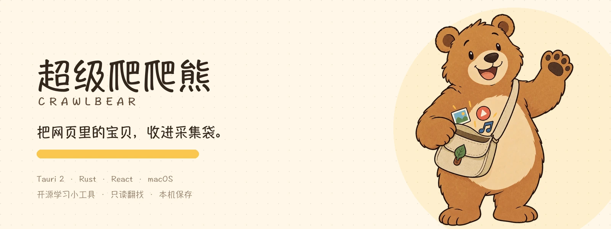
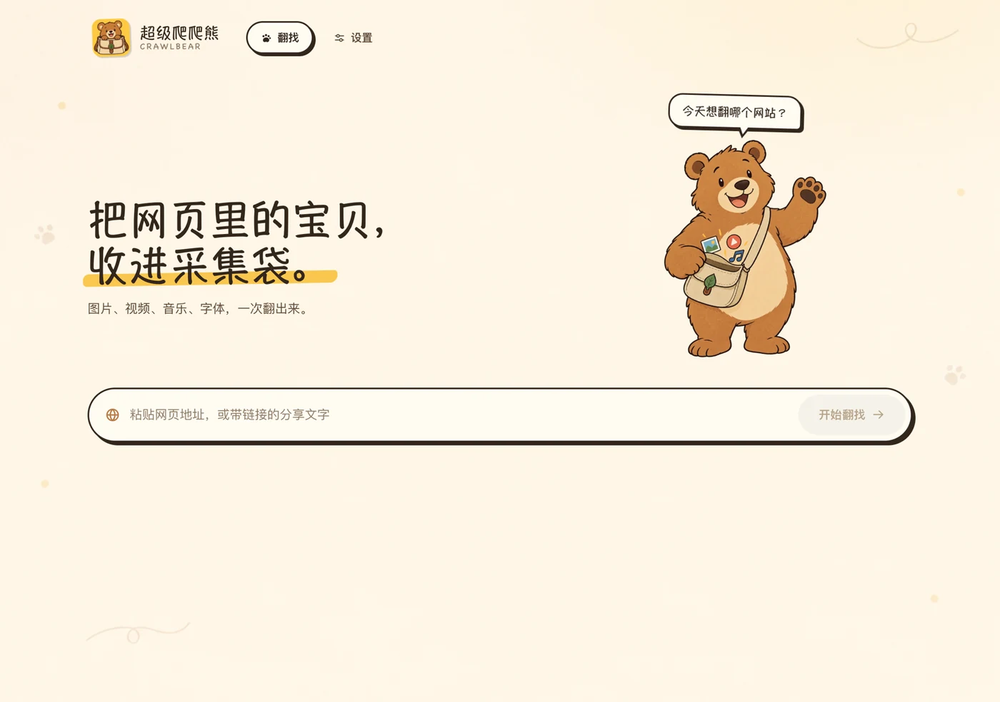
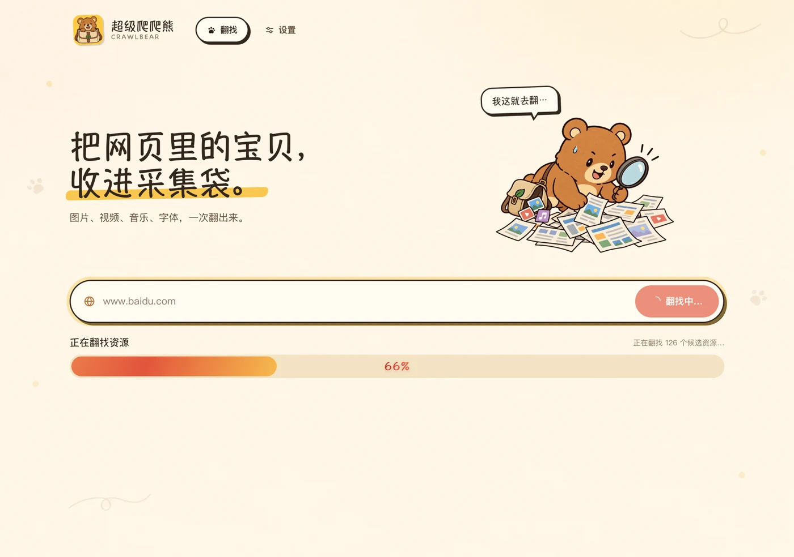
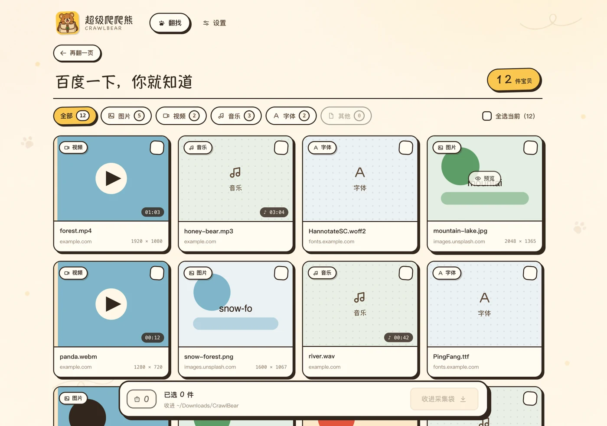
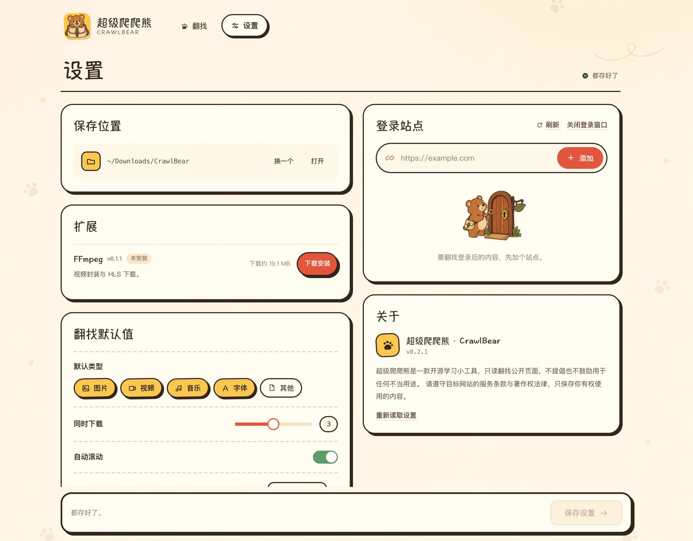
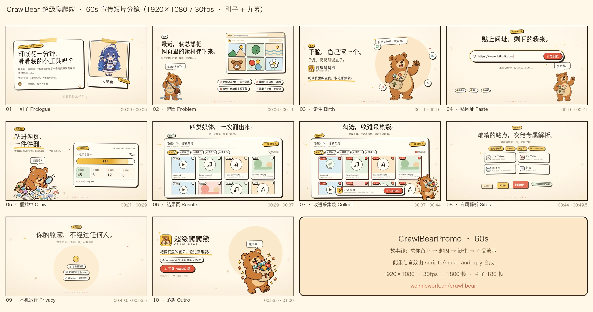

<div align="center">



**输入一个网址，把网页里的图片、视频、音乐与字体收进本地文件夹。**


**官网：** [https://we.miework.cn/crawl-bear/index.html](https://we.miework.cn/crawl-bear/index.html)

[English](README.en.md) · 中文

</div>

## 这是什么

超级爬爬熊（CrawlBear）是一个跑在 macOS 本机的网页媒体翻找工具。粘贴任意网页地址，它会打开一个不可见的浏览器窗口，扫描页面里的图片、视频、音乐与字体，让你筛选后批量保存到本地。

没有云端、没有账号、没有遥测；需要登录的站点也只在你自己的 WebView 里手动登录，Cookie 不会离开这台电脑。

仓库使用 **pnpm workspace** 管理：

| 包 | 说明 |
| --- | --- |
| `apps/desktop` | macOS 桌面应用（Tauri 2 + Rust + React） |
| `apps/website` | 官网（Vite + React + TypeScript），已部署到 [we.miework.cn/crawl-bear](https://we.miework.cn/crawl-bear/index.html) |
| `promos/crawl-bear-promo` | 营销素材：60 秒宣传短片（Remotion），见 [宣传短片](#宣传短片) |

完整的工程结构与各包职责见 [docs/STRUCTURE.md](docs/STRUCTURE.md)。

## 特性

- **任意网站**：输入页面地址或粘贴分享文字，可省略 `https://`，会自动补齐。
- **不止 ``**：同时扫描 `picture/srcset`、懒加载 `data-*`、`<video>/<audio>/<source>`、海报、CSS 背景图、`@font-face`、`<link rel=preload>`、`og:image/video`、内联样式、CSSOM 与 `performance` 资源条目。
- **四类媒体**：图片、视频、音乐、字体，可多选筛选、按类型计数、批量勾选。
- **即点即看**：点击任意资源弹出预览窗——图片大图、视频/音频直接播放、字体实时样张。
- **专站解析**：X/Twitter、YouTube、Bilibili、抖音等命中专属解析时，结果页显示「专属解析已启用」标签，并优先取站点内最高清晰度资源。
- **登录站点**：内置 Bilibili、抖音、X、YouTube 常用站点，点一下就能打开内嵌登录窗口；也可手动添加其他站点。Cookie 保存在本机，后续翻找与下载自动复用；只展示 Cookie 数量，不猜测登录状态。
- **可控下载**：按站点域名归档到指定目录；并发 1–5；支持取消；HLS/DASH 通过应用内 FFmpeg 扩展合并为 MP4；每个资源的成功/失败状态实时反馈。
- **原生手感**：固定顶栏、单屏首页、独立结果页；macOS 菜单保留应用菜单（关于 / 设置 / 退出）与「编辑」菜单（撤销 / 重做 / 剪切 / 复制 / 粘贴 / 全选）；禁用右键菜单与文本选中。
- **中英双语**：界面默认跟随系统语言，可在「设置 → 语言」切换 中文 / English；官网按浏览器语言自动选择，也可在导航栏切换。
- **手绘小熊**：卡通漫画风的小熊「爬爬」会陪你翻找，贴纸质感与轻量动效（framer-motion，遵循 reduced-motion）。

## 专属支持的站点

这些站点不走普通抓取，而是有专门的解析链路；结果页会显示「专属解析已启用」。

| 站点 | 支持的链接 | 专属能力 |
| --- | --- | --- |
| X / Twitter | `x.com/.../status/...`、`twitter.com/...` | 自动避开低清 HLS 变体，取最高清晰度视频流（HLS 合并需 FFmpeg 扩展） |
| YouTube | `youtube.com/watch?v=...`、`youtu.be/...`、`/shorts/...` | 自研 visionOS innertube 提取；1080P H.264 + AAC，FFmpeg 合并为 MP4 |
| Bilibili | `bilibili.com/video/BV...`、`av...`、`b23.tv/...`、`?p=N` 多 P | WBI 签名 playurl；登录后跟随账号清晰度；最高 1080P H.264；分 P 拆成多条 |
| 抖音 Douyin | `v.douyin.com/...`、`douyin.com/video/<id>`、`/note/<id>` | 移动端分享页解析；无水印 1080P；视频与图文作品都支持 |

X、YouTube、Bilibili、抖音都已内置一键登录入口（「设置 → 登录站点」）。其他网站走通用抓取；如果遇到想要专属适配的站点，欢迎在 GitHub 提 Issue。

## 界面

### 首页



### 翻找中

进度条居中显示流光百分比，小熊切换成翻找姿态。



### 结果页

按类型筛选、全选、批量收进采集袋；翻找完成后进入独立结果页，列表在页内滚动。



### 设置

保存位置、默认类型、并发、滚动、单次上限与登录站点都保存在本机。



## 宣传短片

`promos/crawl-bear-promo` 是仓库里的营销素材子包：一段 **60 秒、1920×1080 / 30fps** 的产品短片（开头 6 秒是作者口吻的「引子」，然后是九幕产品介绍），用 Remotion 写成——画面全部由 React 组件逐帧绘制，配乐与音效由脚本合成，不依赖剪辑软件，也不依赖任何版权素材。



- 十幕：引子（求你看一分钟）→ 起因（想存网页素材）→ 诞生（干脆自己写，爬爬熊登场）→ 贴网址 → 翻找中 → 结果页 → 收进采集袋 → 专属解析 → 本机运行 → 落版；
- 预览：`pnpm dev:promo`（Remotion Studio，可拖时间轴逐帧看）；
- 两个版本：`CrawlBearPromo`（标准版）和 `CrawlBearPromoNoLink`（去外链版：域名用 `xxxx.xx.com` 占位、专属解析不出现平台名、落版改成「私聊作者获取」，给抖音 / 视频号等审核较严的平台）；
- 出片：`pnpm render:promo`（标准版）/ `pnpm render:promo:nolink`（去外链版）→ `promos/crawl-bear-promo/out/*.mp4`；
- 改文案 / 时长 / 配乐：见 [promos/crawl-bear-promo/README.md](promos/crawl-bear-promo/README.md)；
- 只有 1 张图需要自己生成（引子拍立得里的大肥鱼），完整提示词见 [promos/crawl-bear-promo/ASSETS.md](promos/crawl-bear-promo/ASSETS.md)，放在 `generated/` 后跑 `pnpm --filter @crawl-bear/promo art` 即可。

## 快速开始

### 环境要求

- macOS 13+
- Node.js 20+
- Rust 1.77+（rustup）与 Xcode Command Line Tools
- 系统 `/usr/bin/curl`
- 不再需要系统安装 ffmpeg；首次使用 YouTube/Bilibili 下载或 HLS 前，在应用内「设置 → 扩展管理」安装即可
- 宣传短片（可选）：Remotion 会在首次渲染时自动下载 Chrome Headless Shell；重新合成配乐需要 `python3` + `numpy`

### 扩展管理

设置里有一个「扩展」面板，目前提供 FFmpeg：

- 点击「下载安装」后，应用会下载对应架构的静态构建，解压、校验并安装到应用私有数据目录；
- 不会写入 `/opt/homebrew`、`/usr/local` 或系统 PATH，也不会调用全局 ffmpeg；
- 下载支持断点重试，安装完成后显示版本、体积和许可证；
- 可以在同一面板移除；移除后依赖 FFmpeg 的 YouTube/Bilibili 合并与 HLS 下载会提示重新安装。

### 安装依赖

```bash
pnpm install
```

### 开发运行

```bash
# 桌面应用（首次会编译 Rust 依赖）
pnpm dev:desktop

# 官网，http://localhost:5173
pnpm dev:web

# 宣传片 Remotion Studio，http://localhost:3000
pnpm dev:promo
```

### 构建发布

```bash
# 桌面应用
pnpm build:desktop

# 官网
pnpm build:web

# 宣传片 bundle（不渲染视频，只打包）
pnpm build:promo

# 三个包一起构建：桌面端 + 官网 + 宣传片 bundle
pnpm build

# 渲染宣传片 MP4（需要 Chrome，约 2–4 分钟）
pnpm render:promo

# 打可直接分发的 macOS 包（ad-hoc 签名 + 安装说明）
pnpm package:macos
```

桌面应用产物：`apps/desktop/src-tauri/target/release/bundle/macos/CrawlBear.app`。
`pnpm package:macos` 会重新做 ad-hoc 签名，并生成：

产物统一输出到 `dist/`（已加入 `.gitignore`，不要提交）：

- `dist/CrawlBear-macOS.pkg`：自动安装到 `/Applications`（推荐发给普通用户）；
- `dist/CrawlBear-macOS.zip`：免安装包，内含应用与安装说明。

没有 Apple Developer 账号时，用户首次打开会触发 Gatekeeper。请把 [docs/INSTALL-macOS.md](docs/INSTALL-macOS.md) 一起发给对方，按里面的右键打开或终端命令处理；不要全局关闭 Gatekeeper。

### 图片与图标资产

```bash
# 生图原稿 -> 应用 WebP + 官网副本 + 圆角图标
python3 scripts/prepare_assets.py

# 图标有改动时，重新生成 Tauri 图标
pnpm --filter @crawl-bear/desktop exec tauri icon ../../design-assets/app-icon-rounded.png

# 宣传片：把生成图处理成 WebP（清单见 promos/crawl-bear-promo/ASSETS.md）
pnpm --filter @crawl-bear/promo art

# 宣传片：重新合成配乐与音效（python3 + numpy，幂等）
pnpm --filter @crawl-bear/promo audio
```

## 使用

1. 在首页粘贴网页地址，例如 `https://developer.mozilla.org/`，也可以省略协议；
2. 等小熊翻找完成，自动进入结果页；
3. 用「全部 / 图片 / 视频 / 音乐 / 字体 / 其他」筛选，点击卡片可预览；
4. 勾选需要的素材（或点「全选当前」），点底部「收进采集袋」；
5. 文件保存到「设置 → 保存位置」指定的目录，默认是 `~/Downloads/CrawlBear/<站点域名>/`。

### 登录站点

先到「设置 → 登录站点」添加站点地址，点「打开登录」在独立窗口中手动登录，关闭窗口后回到首页重新翻找即可。登录窗口按域名复用；「清除」只删除本机 Cookie。

### 设置项

| 设置 | 说明 |
| --- | --- |
| 保存位置 | 下载根目录，按站点域名创建子目录 |
| 默认类型 | 翻找结果默认显示哪些媒体类型 |
| 同时下载 | 并发下载任务数，1–5 |
| 自动滚动 | 打开后先滚动页面触发懒加载，再提取资源 |
| 单次最多 | 单次翻找的资源上限，50–2000 |
| 登录站点 | 需要登录后才可见内容的站点 |
| 界面语言 | 跟随系统 / 中文 / English |

## 工程结构

```text
apps/                             应用（用户直接安装 / 访问）
  desktop/                        macOS 桌面应用（Tauri 2 + Rust + React）
    src/                          React UI（app / features / shared）
    src-tauri/                    Rust 后端、Tauri 配置与图标
    public/assets/                应用内 WebP（小熊插画、底纹、Logo）
  website/                        官网
    src/                          Vite + React 页面
    public/assets/                brand / shots / generated 图片
    ASSETS.md                     官网生图提示词
promos/                           营销素材（不参与应用构建）
  crawl-bear-promo/               60s 宣传短片（Remotion，含引子）
    src/                          theme / lib / components / scenes / audio
    public/assets/                brand / shots / generated 图片
    public/audio/                 合成配乐与音效
    scripts/                      make_audio.py / apply_art.py
    BRIEF.md · ASSETS.md          制作规范 / 生图清单与提示词
assets/readme/                    README 与文档配图
design-assets/                    生图原稿（本地保留，不提交）
scripts/prepare_assets.py         生图原稿 -> WebP / 圆角图标 / 官网同步
docs/
  STRUCTURE.md                    工程结构总览：包职责、依赖、资产流水线、改哪里
  design.md                       设计规范：品牌、色彩、字体、布局、动效
  assets.md                       生图资产清单与提示词
  ARCHITECTURE.md                 分层、数据流、扩展点
  API_CONTRACT.md                 前后端命令/事件/错误码契约
  media-extraction.md             通用媒体提取脚本与实测报告
pnpm-workspace.yaml               workspace 配置（apps/* + promos/*）
```

> `design-assets/`、`docs/screenshots/`、`docs/archive/` 仅保留在本地，不随仓库提交；生图原稿可按 `docs/assets.md` 重新生成。

## 架构与文档

| 文档 | 内容 |
| --- | --- |
| [docs/STRUCTURE.md](docs/STRUCTURE.md) | 工程结构总览：三个子包的职责、依赖约定、资产流水线、发布流程 |
| [docs/design.md](docs/design.md) | 设计规范：手绘贴纸体系、排版、动效、文案与无障碍 |
| [docs/ARCHITECTURE.md](docs/ARCHITECTURE.md) | Rust / React 分层、数据流、扩展点 |
| [docs/API_CONTRACT.md](docs/API_CONTRACT.md) | Tauri 命令、事件与错误码 |
| [docs/media-extraction.md](docs/media-extraction.md) | 通用媒体提取脚本与双内核实测 |
| [docs/assets.md](docs/assets.md) | 小熊插画 / 底纹 / 图标的生图提示词 |
| [apps/website/ASSETS.md](apps/website/ASSETS.md) | 官网首屏 / 预览区块 / 社交分享图提示词 |
| [promos/crawl-bear-promo/README.md](promos/crawl-bear-promo/README.md) | 宣传短片：预览、渲染、分镜、目录结构 |
| [promos/crawl-bear-promo/ASSETS.md](promos/crawl-bear-promo/ASSETS.md) | 宣传短片的生图清单：1 张图 + 完整提示词 |

## 测试与验证

```bash
# Rust 单元测试（URL、命名、分类、下载路径规划等）
pnpm test:rust

# 三个包的类型检查与构建（含宣传片 bundle）
pnpm build
```

已完成的验证：

- 50 个 Rust 测试全部通过（3 个联网集成测试默认跳过）；
- 真实 WKWebView 实测百度首页：发现 79 张图片、6 个字体，`.js/.css` 等非媒体资源已被过滤；
- 发布版 macOS 应用启动冒烟、内嵌资源与图标校验通过；
- 首页、翻找中、结果页、预览弹窗、下载完成、设置页均逐屏截图校验（截图为本地验证产物，不随仓库提交）；
- 官网与桌面应用均在 pnpm workspace 下完成生产构建；
- 宣传短片关键帧逐帧抽检、带音轨 MP4 试渲染通过，`promos/` 与 `apps/` 同在 pnpm workspace 下构建。

## 已知限制

- 仅 macOS 实现；Windows/Linux 需要替换 `open`、路径与 WebView 细节。
- `blob:` / MSE 流、iframe 内部资源、closed Shadow DOM、提取后由脚本写入的背景图无法覆盖。
- 部分站点有反爬、登录墙、验证码；本工具不绕过验证码，只复用用户手动完成的登录状态。
- YouTube、Bilibili、抖音页面视频由应用内提取；其他站点（Vimeo 等）的播放页暂不支持应用内下载。
- Bilibili 暂不支持番剧、影视、付费或充电专属内容；未登录时最高 480P。
- 抖音支持公开的视频和图文作品；直播、主页批量作品和合集暂不支持，私密或已删除作品会提示失败。
- YouTube/Bilibili 下载需要先在「设置 → 扩展管理」安装 FFmpeg 扩展；代理环境会自动读取 macOS 系统代理。
- 签名 CDN 地址可能过期；每次下载前重新采集，不缓存直链。
- 隐藏窗口不会触发显示器刷新，已用定时器兜底 `requestAnimationFrame`；依赖 `IntersectionObserver` 的懒加载图片可能少于可见浏览器。
- 仅用于下载你有权保存的内容。请遵守目标网站的服务条款与著作权法律，不要二次传播。

## 免责声明

超级爬爬熊是一款开源学习小工具，只在本机只读翻找公开页面，不提倡、也不鼓励用于任何不当用途。请尊重网站条款与版权，仅保存你有权使用的内容。

## 许可证

本项目基于 [MIT License](LICENSE) 开源。

## 致谢

[Tauri](https://tauri.app/) · [React](https://react.dev/) · [Ant Design](https://ant.design/) · [framer-motion](https://www.framer.com/motion/) · [ffmpeg](https://ffmpeg.org/)
